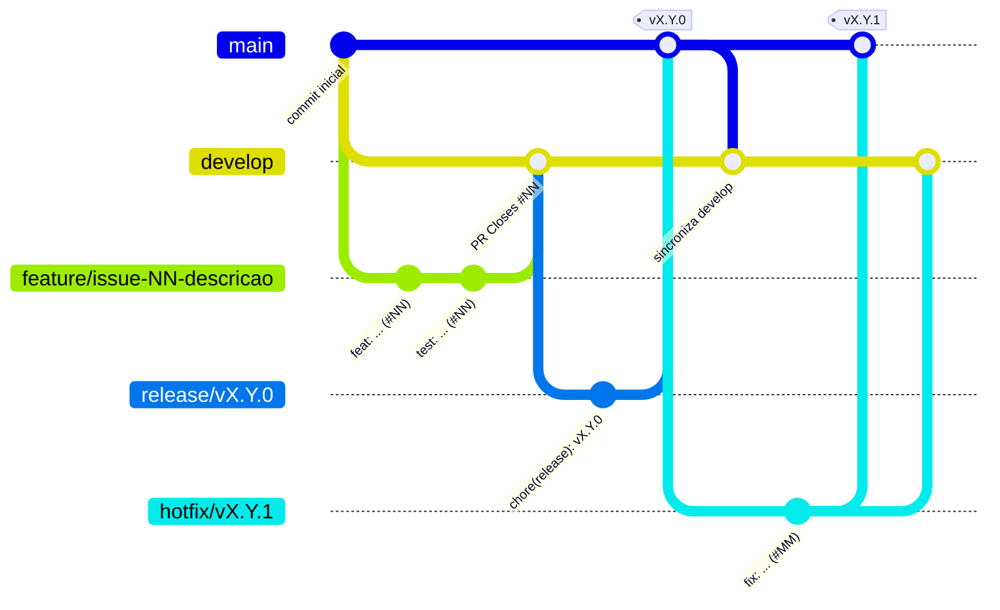
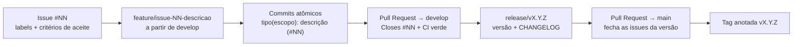

# 🧫 Antimicrobiano Inteligente

[](https://github.com/Antonio-avsp/Projeto_Antimicrobiano_Inteligente/tags)
[](https://github.com/Antonio-avsp/Projeto_Antimicrobiano_Inteligente/actions/workflows/ci.yml)
[](LICENSE)


[](https://www.conventionalcommits.org/pt-br/v1.0.0/)
[](CONTRIBUTING.md)

**API REST de apoio ao Programa de Gerenciamento do Uso de Antimicrobianos (PGA / *antimicrobial stewardship*)**. Centraliza prescrições, culturas e antibiogramas de pacientes internados e usa um **motor de regras explicável** para alertar a equipe do PGA sobre tratamentos que precisam de intervenção: reavaliação de 72 horas, duração excedida, uso restrito sem justificativa, microrganismo resistente, oportunidade de descalonamento e mais.

> ⚠️ **Projeto acadêmico.** Ferramenta de **apoio à decisão** que não substitui o julgamento clínico. Utilize apenas dados fictícios.

## Sumário

- [O problema](#o-problema)
- [A solução](#a-solução)
- [Funcionalidades](#funcionalidades)
- [Stack tecnológica](#stack-tecnológica)
- [Como executar localmente](#como-executar-localmente)
- [Exemplos de uso](#exemplos-de-uso)
- [Documentação do projeto](#documentação-do-projeto)
- [Fluxo de trabalho (Git Flow, commits e versões)](#fluxo-de-trabalho-git-flow-commits-e-versões)
- [Roadmap e versões](#roadmap-e-versões)
- [Estrutura do repositório](#estrutura-do-repositório)
- [Autor e licença](#autor-e-licença)

## O problema

A **resistência antimicrobiana** esteve diretamente associada a cerca de **1,27 milhão de mortes** no mundo em 2019 (*The Lancet*, 2022), e **30% a 50%** das prescrições hospitalares de antimicrobianos são consideradas desnecessárias ou inadequadas. Em hospitais de pequeno e médio porte, a equipe do PGA acompanha os tratamentos manualmente, em planilhas, o que causa:

- tratamentos que passam de **72 horas sem reavaliação** ou **excedem a duração prevista**;
- **terapias inadequadas** não detectadas (microrganismo resistente ao antimicrobiano em uso);
- **oportunidades de descalonamento** perdidas;
- critérios pouco padronizados e intervenções sem registro estruturado.

## A solução

O **Antimicrobiano Inteligente** cruza automaticamente prescrições, culturas e antibiogramas e gera, para cada data de referência, um **painel priorizado de alertas**. Cada alerta informa a regra aplicada, a severidade, as **evidências** usadas e a **recomendação** de conduta.

| Alerta | Quando dispara | Severidade |
|---|---|---|
| `TIMEOUT_REAVALIACAO` | Prescrição ativa há 72 h ou mais sem reavaliação | 🟡 MEDIA |
| `DURACAO_EXCEDIDA` | Dia de terapia maior que a duração prevista | 🟡 MEDIA |
| `PROFILAXIA_PROLONGADA` | Profilaxia planejada por mais de 24 h | 🟡 MEDIA |
| `RESTRITO_SEM_JUSTIFICATIVA` | Antimicrobiano de uso restrito sem justificativa | 🔴 ALTA |
| `SEM_CULTURA` | Antimicrobiano WATCH/RESERVE empírico sem cultura coletada | 🟡 MEDIA |
| `RESISTENCIA` | Cultura do paciente resistente (`R`) ao antimicrobiano prescrito | 🔴 ALTA |
| `DESCALONAMENTO` | Antibiograma permite opção de categoria AWaRe inferior | 🔵 BAIXA |

As regras seguem diretrizes reconhecidas — classificação **AWaRe** da OMS, diretriz nacional de PGA da **ANVISA**, recomendações **IDSA/SHEA** e norma **CLSI M39** — e estão detalhadas nas [regras de negócio](docs/requisitos.md#3-regras-de-negócio-rn).

## Funcionalidades

Legenda: ✅ implementado · 🚧 em desenvolvimento · 🗓️ planejado

| Funcionalidade | Requisito | Issue | Versão | Status |
|---|---|---|---|---|
| Documentação de planejamento (termo de abertura, requisitos, casos de uso, histórias, arquitetura) | — | [#1](https://github.com/Antonio-avsp/Projeto_Antimicrobiano_Inteligente/issues/1)–[#5](https://github.com/Antonio-avsp/Projeto_Antimicrobiano_Inteligente/issues/5) | v0.1.0 | ✅ |
| API base com `/health` e documentação interativa (Swagger UI) | RNF03 | [#6](https://github.com/Antonio-avsp/Projeto_Antimicrobiano_Inteligente/issues/6) | v0.1.0 | ✅ |
| Pipeline de CI (pytest em Python 3.11–3.13) | RNF06, RNF08 | [#7](https://github.com/Antonio-avsp/Projeto_Antimicrobiano_Inteligente/issues/7) | v0.1.0 | ✅ |
| Catálogo de antimicrobianos com classificação AWaRe | RF01, RF02 | [#9](https://github.com/Antonio-avsp/Projeto_Antimicrobiano_Inteligente/issues/9) | v0.2.0 | 🗓️ |
| Registro, consulta e atualização de prescrições | RF03, RF04 | [#10](https://github.com/Antonio-avsp/Projeto_Antimicrobiano_Inteligente/issues/10) | v0.2.0 | 🗓️ |
| Reavaliação (time-out) e encerramento de prescrições | RF05 | [#11](https://github.com/Antonio-avsp/Projeto_Antimicrobiano_Inteligente/issues/11) | v0.2.0 | 🗓️ |
| Culturas e antibiogramas (S/I/R) | RF06 | [#12](https://github.com/Antonio-avsp/Projeto_Antimicrobiano_Inteligente/issues/12) | v0.2.0 | 🗓️ |
| Alertas de time-out, duração excedida e profilaxia prolongada | RF07, RF08 | [#13](https://github.com/Antonio-avsp/Projeto_Antimicrobiano_Inteligente/issues/13) | v0.3.0 | 🗓️ |
| Alertas de uso restrito sem justificativa e de amplo espectro sem cultura | RF09, RF12 | [#14](https://github.com/Antonio-avsp/Projeto_Antimicrobiano_Inteligente/issues/14) | v0.3.0 | 🗓️ |
| Alertas de resistência e sugestão de descalonamento | RF10, RF11 | [#15](https://github.com/Antonio-avsp/Projeto_Antimicrobiano_Inteligente/issues/15) | v0.3.0 | 🗓️ |
| Painel de alertas com filtros e resumo | RF13 | [#16](https://github.com/Antonio-avsp/Projeto_Antimicrobiano_Inteligente/issues/16) | v0.3.0 | 🗓️ |
| Antibiograma cumulativo institucional | RF14 | [#17](https://github.com/Antonio-avsp/Projeto_Antimicrobiano_Inteligente/issues/17) | v0.3.0 | 🗓️ |
| Parâmetros clínicos configuráveis por ambiente | RNF11 | [#18](https://github.com/Antonio-avsp/Projeto_Antimicrobiano_Inteligente/issues/18) | v0.3.0 | 🗓️ |
| Carga de dados fictícios para demonstração | HT01 | [#19](https://github.com/Antonio-avsp/Projeto_Antimicrobiano_Inteligente/issues/19) | v0.3.0 | 🗓️ |
| Gates de qualidade no CI (ruff + cobertura mínima) | RNF07, RNF08 | [#20](https://github.com/Antonio-avsp/Projeto_Antimicrobiano_Inteligente/issues/20) | v1.0.0 | 🗓️ |
| Indicadores de consumo (DOT) | RF15 | [#21](https://github.com/Antonio-avsp/Projeto_Antimicrobiano_Inteligente/issues/21) | v1.0.0 | 🗓️ |
| Alerta de duplicidade terapêutica | RF16 | [#22](https://github.com/Antonio-avsp/Projeto_Antimicrobiano_Inteligente/issues/22) | v1.0.0 | 🗓️ |
| Autenticação e perfis de acesso | RF17 | [#24](https://github.com/Antonio-avsp/Projeto_Antimicrobiano_Inteligente/issues/24) | v1.0.0 | 🗓️ |
| Interface web do painel de alertas | RF18 | [#26](https://github.com/Antonio-avsp/Projeto_Antimicrobiano_Inteligente/issues/26) | v1.0.0 | 🗓️ |

O detalhamento de cada requisito está em [docs/requisitos.md](docs/requisitos.md) e a ligação requisito → issue → teste em [docs/rastreabilidade.md](docs/rastreabilidade.md).

## Stack tecnológica

| Camada | Tecnologia | Por quê |
|---|---|---|
| Linguagem | Python 3.11+ | Legibilidade, ecossistema de saúde/dados e ampla adoção acadêmica |
| Framework web | FastAPI + Uvicorn | Validação declarativa e documentação OpenAPI automática |
| Validação | Pydantic v2 | Contratos de entrada e saída tipados |
| Persistência | SQLite + SQLAlchemy 2.0 | Zero configuração; troca para PostgreSQL apenas por variável de ambiente |
| Testes | pytest, pytest-cov, httpx | Testes de unidade e de API com relatório de cobertura |
| Qualidade | ruff | Lint e formatação no padrão PEP 8 |
| CI | GitHub Actions | Testes automáticos em cada push e pull request |
| Documentação | Markdown + Mermaid | Diagramas versionados junto com o código e renderizados pelo GitHub |

## Como executar localmente

### Pré-requisitos

- [Python](https://www.python.org/downloads/) **3.11 ou superior** (`python --version`)
- [Git](https://git-scm.com/downloads)

### Passo a passo

**1. Clonar o repositório**

```bash
git clone https://github.com/Antonio-avsp/Projeto_Antimicrobiano_Inteligente.git
cd Projeto_Antimicrobiano_Inteligente
```

**2. Criar e ativar o ambiente virtual**

```bash
python -m venv .venv
```

| Sistema | Comando de ativação |
|---|---|
| Windows (PowerShell) | `.venv\Scripts\Activate.ps1` |
| Windows (cmd) | `.venv\Scripts\activate.bat` |
| Linux / macOS | `source .venv/bin/activate` |

**3. Instalar a aplicação e as dependências de desenvolvimento**

```bash
pip install -e ".[dev]"
```

**4. Iniciar a API**

```bash
uvicorn antimicrobiano.main:app --reload
```

**5. Acessar a documentação interativa** em <http://127.0.0.1:8000/docs> (Swagger UI) ou <http://127.0.0.1:8000/redoc>.

**6. Executar os testes e a análise estática**

```bash
pytest --cov
```

```bash
ruff check .
```

### Variáveis de ambiente

| Variável | Padrão | Descrição |
|---|---|---|
| `AMI_DATABASE_URL` | `sqlite:///./antimicrobiano.db` | URL de conexão do banco. O arquivo SQLite é criado automaticamente na primeira execução. |

## Exemplos de uso

Com a API em execução:

```bash
curl http://127.0.0.1:8000/health
```

```json
{
  "status": "ok",
  "versao": "0.1.0",
  "aviso": "Ferramenta de apoio à decisão para fins acadêmicos: não substitui o julgamento clínico. Utilize apenas dados fictícios."
}
```

Os exemplos dos recursos de negócio (antimicrobianos, prescrições, culturas e alertas) são adicionados a esta seção conforme cada funcionalidade é entregue.

## Documentação do projeto

| Documento | Conteúdo |
|---|---|
| [📋 Termo de Abertura](docs/project-charter.md) | Justificativa, visão do produto, objetivos SMART, escopo, stakeholders, riscos e marcos |
| [📐 Requisitos](docs/requisitos.md) | Requisitos funcionais (RF), não funcionais (RNF) e regras de negócio (RN) |
| [🎭 Casos de Uso](docs/casos-de-uso.md) | Atores, diagrama e fluxos principal, alternativos e de exceção |
| [📖 Histórias de Usuário](docs/user-stories.md) | Histórias no padrão canônico com critérios de aceite em Gherkin |
| [🏛️ Arquitetura](docs/arquitetura.md) | Modelo C4, camadas, motor de regras, fluxo de alertas e decisões técnicas |
| [🗃️ Modelo de Dados](docs/modelo-de-dados.md) | DER, dicionário de dados, diagrama de classes e enumerações |
| [🔗 Rastreabilidade](docs/rastreabilidade.md) | Matriz requisito → caso de uso → história → issue → release → teste |
| [📚 Glossário](docs/glossario.md) | Termos do domínio (AWaRe, time-out, descalonamento, S/I/R…) |
| [🤝 Guia de Contribuição](CONTRIBUTING.md) | Git Flow, Conventional Commits, Pull Requests, SemVer e Definição de Pronto |
| [📝 CHANGELOG](CHANGELOG.md) | Histórico de mudanças de cada versão |

## Fluxo de trabalho (Git Flow, commits e versões)

### Branches

| Branch | Origem | Destino | Finalidade |
|---|---|---|---|
| `main` | — | — | Produção: apenas versões liberadas, marcadas com tags `vX.Y.Z`. Sem commits diretos. |
| `develop` | `main` | — | Integração das funcionalidades da próxima versão. |
| `feature/issue-NN-descricao` | `develop` | `develop` (PR) | Uma branch por issue. Ex.: `feature/issue-09-catalogo-antimicrobianos`. |
| `release/vX.Y.Z` | `develop` | `main` (PR) e `develop` | Preparação da versão: número de versão e CHANGELOG. |
| `hotfix/vX.Y.Z` | `main` | `main` (PR) e `develop` | Correção urgente em produção. |



### Ciclo de vida de uma issue



### Commits (Conventional Commits)

Formato `tipo(escopo): descrição no imperativo (#issue)`, com commits pequenos e autossuficientes:

```text
docs(charter): definir objetivos SMART do software (#1)
feat(api): criar aplicação FastAPI com conexão SQLite e endpoint /health (#6)
ci: adicionar workflow de testes com matriz Python 3.11 a 3.13 (#7)
```

### Versionamento Semântico

Versões no formato `MAJOR.MINOR.PATCH`, marcadas com **tags anotadas** na `main` ao final de cada marco. Enquanto a versão for `0.y.z`, a API está em desenvolvimento inicial. Detalhes no [Guia de Contribuição](CONTRIBUTING.md).

## Roadmap e versões

| Versão | Marco | Issues | Status |
|---|---|---|---|
| `v0.1.0` | Documentação de planejamento e fundação técnica (setup, CI, README) | #1 a #8 | 🚧 em preparação |
| `v0.2.0` | Cadastros essenciais: catálogo, prescrições, reavaliação/encerramento e culturas | #9 a #12 | 🗓️ |
| `v0.3.0` | Motor de regras inteligente, painel de alertas, antibiograma cumulativo e dados de demonstração | #13 a #19 | 🗓️ |
| `v1.0.0` | Gates de qualidade, indicadores DOT, duplicidade terapêutica, autenticação e interface web | #20 a #26 | 🗓️ |

Versões publicadas: [tags](https://github.com/Antonio-avsp/Projeto_Antimicrobiano_Inteligente/tags) · histórico: [CHANGELOG](CHANGELOG.md).

## Estrutura do repositório

```text
Projeto_Antimicrobiano_Inteligente/
├── .github/
│   ├── ISSUE_TEMPLATE/            # Templates de issue (funcionalidade, bug, documentação)
│   ├── workflows/ci.yml           # Pipeline de CI (GitHub Actions)
│   └── pull_request_template.md   # Template de Pull Request
├── docs/                          # Documentação de planejamento e engenharia
│   ├── project-charter.md
│   ├── requisitos.md
│   ├── casos-de-uso.md
│   ├── user-stories.md
│   ├── arquitetura.md
│   ├── modelo-de-dados.md
│   ├── rastreabilidade.md
│   └── glossario.md
├── src/antimicrobiano/            # Código-fonte da API
│   ├── main.py                    # Application factory (create_app)
│   ├── config.py                  # Configuração por variáveis de ambiente
│   ├── database.py                # Engine e sessões do SQLAlchemy
│   ├── routers/                   # Camada HTTP (rotas)
│   └── schemas/                   # Contratos Pydantic
├── tests/                         # Testes automatizados (pytest)
├── .gitignore
├── CHANGELOG.md
├── CONTRIBUTING.md
├── LICENSE
├── pyproject.toml                 # Metadados, dependências e configuração das ferramentas
└── README.md
```

## Autor e licença

Desenvolvido por [Antonio-avsp](https://github.com/Antonio-avsp) na atividade prática *Especificação, Gestão com Issues e SDLC no GitHub*.

Distribuído sob a licença [MIT](LICENSE).
