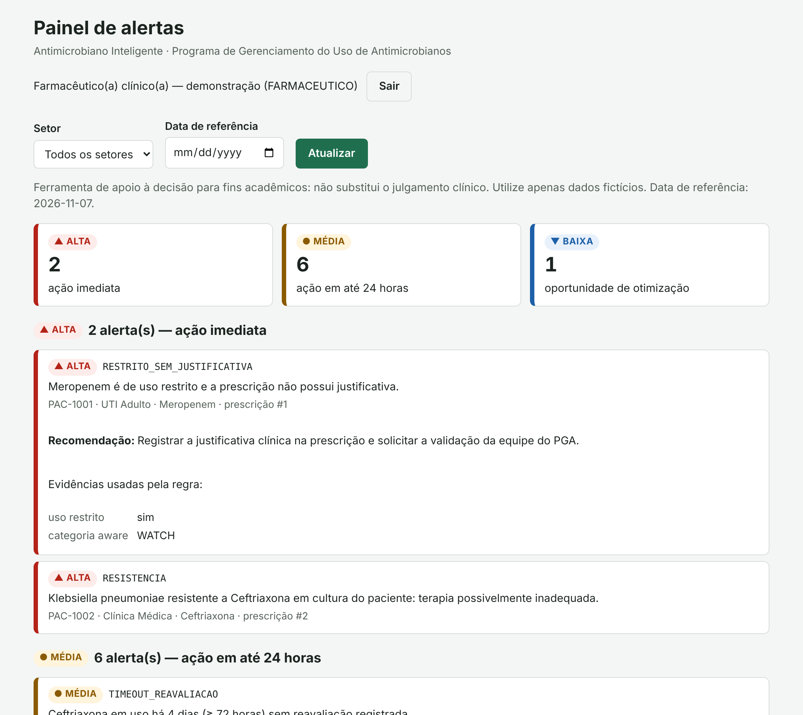
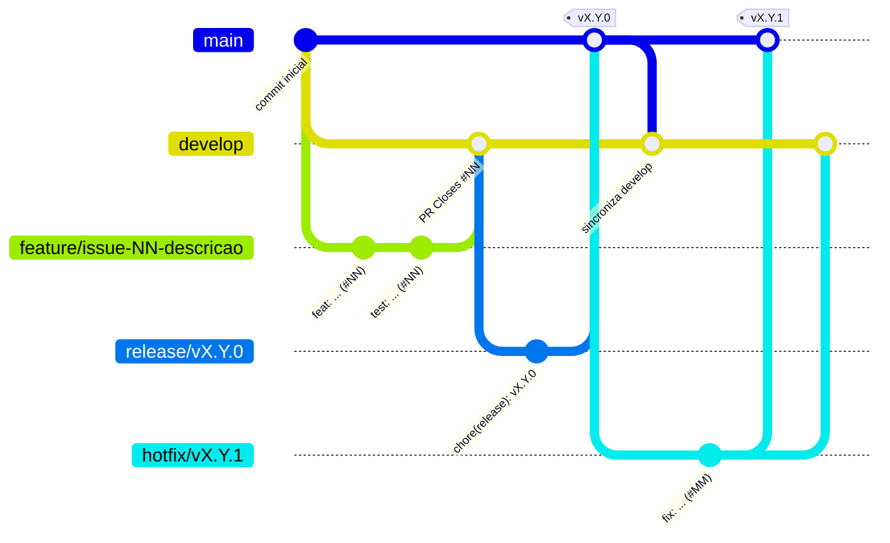
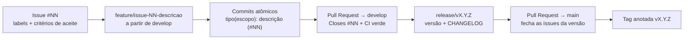

# 🧫 Antimicrobiano Inteligente

[](https://github.com/Antonio-avsp/Projeto_Antimicrobiano_Inteligente/tags)
[](https://github.com/Antonio-avsp/Projeto_Antimicrobiano_Inteligente/actions/workflows/ci.yml)
[](LICENSE)


[](https://www.conventionalcommits.org/pt-br/v1.0.0/)
[](CONTRIBUTING.md)

**API REST de apoio ao Programa de Gerenciamento do Uso de Antimicrobianos (PGA / *antimicrobial stewardship*)**. Centraliza prescrições, culturas e antibiogramas de pacientes internados e usa um **motor de regras explicável** para alertar a equipe do PGA sobre tratamentos que precisam de intervenção: reavaliação de 72 horas, duração excedida, uso restrito sem justificativa, microrganismo resistente, oportunidade de descalonamento e mais.

> ⚠️ **Projeto acadêmico.** Ferramenta de **apoio à decisão** que não substitui o julgamento clínico. Utilize apenas dados fictícios.

## Sumário

- [O problema](#o-problema)
- [A solução](#a-solução)
- [Funcionalidades](#funcionalidades)
- [Stack tecnológica](#stack-tecnológica)
- [Como executar localmente](#como-executar-localmente)
- [Exemplos de uso](#exemplos-de-uso)
- [Documentação do projeto](#documentação-do-projeto)
- [Fluxo de trabalho (Git Flow, commits e versões)](#fluxo-de-trabalho-git-flow-commits-e-versões)
- [Roadmap e versões](#roadmap-e-versões)
- [Estrutura do repositório](#estrutura-do-repositório)
- [Autor e licença](#autor-e-licença)

## O problema

A **resistência antimicrobiana** esteve diretamente associada a cerca de **1,27 milhão de mortes** no mundo em 2019 (*The Lancet*, 2022), e **30% a 50%** das prescrições hospitalares de antimicrobianos são consideradas desnecessárias ou inadequadas. Em hospitais de pequeno e médio porte, a equipe do PGA acompanha os tratamentos manualmente, em planilhas, o que causa:

- tratamentos que passam de **72 horas sem reavaliação** ou **excedem a duração prevista**;
- **terapias inadequadas** não detectadas (microrganismo resistente ao antimicrobiano em uso);
- **oportunidades de descalonamento** perdidas;
- critérios pouco padronizados e intervenções sem registro estruturado.

## A solução

O **Antimicrobiano Inteligente** cruza automaticamente prescrições, culturas e antibiogramas e gera, para cada data de referência, um **painel priorizado de alertas**. Cada alerta informa a regra aplicada, a severidade, as **evidências** usadas e a **recomendação** de conduta.

| Alerta | Quando dispara | Severidade |
|---|---|---|
| `TIMEOUT_REAVALIACAO` | Prescrição ativa há 72 h ou mais sem reavaliação | 🟡 MEDIA |
| `DURACAO_EXCEDIDA` | Dia de terapia maior que a duração prevista | 🟡 MEDIA |
| `PROFILAXIA_PROLONGADA` | Profilaxia planejada por mais de 24 h | 🟡 MEDIA |
| `RESTRITO_SEM_JUSTIFICATIVA` | Antimicrobiano de uso restrito sem justificativa | 🔴 ALTA |
| `SEM_CULTURA` | Antimicrobiano WATCH/RESERVE empírico sem cultura coletada | 🟡 MEDIA |
| `RESISTENCIA` | Cultura do paciente resistente (`R`) ao antimicrobiano prescrito | 🔴 ALTA |
| `DESCALONAMENTO` | Antibiograma permite opção de categoria AWaRe inferior | 🔵 BAIXA |
| `DUPLICIDADE_TERAPEUTICA` | Paciente com duas prescrições ativas da mesma classe | 🟡 MEDIA |

As regras seguem diretrizes reconhecidas — classificação **AWaRe** da OMS, diretriz nacional de PGA da **ANVISA**, recomendações **IDSA/SHEA** e norma **CLSI M39** — e estão detalhadas nas [regras de negócio](docs/requisitos.md#3-regras-de-negócio-rn).

## Funcionalidades

Legenda: ✅ implementado · 🚧 em desenvolvimento · 🗓️ planejado

| Funcionalidade | Requisito | Issue | Versão | Status |
|---|---|---|---|---|
| Documentação de planejamento (termo de abertura, requisitos, casos de uso, histórias, arquitetura) | — | [#1](https://github.com/Antonio-avsp/Projeto_Antimicrobiano_Inteligente/issues/1)–[#5](https://github.com/Antonio-avsp/Projeto_Antimicrobiano_Inteligente/issues/5) | v0.1.0 | ✅ |
| API base com `/health` e documentação interativa (Swagger UI) | RNF03 | [#6](https://github.com/Antonio-avsp/Projeto_Antimicrobiano_Inteligente/issues/6) | v0.1.0 | ✅ |
| Pipeline de CI (pytest em Python 3.11–3.13) | RNF06, RNF08 | [#7](https://github.com/Antonio-avsp/Projeto_Antimicrobiano_Inteligente/issues/7) | v0.1.0 | ✅ |
| Catálogo de antimicrobianos com classificação AWaRe | RF01, RF02 | [#9](https://github.com/Antonio-avsp/Projeto_Antimicrobiano_Inteligente/issues/9) | v0.2.0 | ✅ |
| Registro, consulta e atualização de prescrições | RF03, RF04 | [#10](https://github.com/Antonio-avsp/Projeto_Antimicrobiano_Inteligente/issues/10) | v0.2.0 | ✅ |
| Reavaliação (time-out) e encerramento de prescrições | RF05 | [#11](https://github.com/Antonio-avsp/Projeto_Antimicrobiano_Inteligente/issues/11) | v0.2.0 | ✅ |
| Culturas e antibiogramas (S/I/R) | RF06 | [#12](https://github.com/Antonio-avsp/Projeto_Antimicrobiano_Inteligente/issues/12) | v0.2.0 | ✅ |
| Alertas de time-out, duração excedida e profilaxia prolongada | RF07, RF08 | [#13](https://github.com/Antonio-avsp/Projeto_Antimicrobiano_Inteligente/issues/13) | v0.3.0 | ✅ |
| Alertas de uso restrito sem justificativa e de amplo espectro sem cultura | RF09, RF12 | [#14](https://github.com/Antonio-avsp/Projeto_Antimicrobiano_Inteligente/issues/14) | v0.3.0 | ✅ |
| Alertas de resistência e sugestão de descalonamento | RF10, RF11 | [#15](https://github.com/Antonio-avsp/Projeto_Antimicrobiano_Inteligente/issues/15) | v0.3.0 | ✅ |
| Painel de alertas com filtros e resumo | RF13 | [#16](https://github.com/Antonio-avsp/Projeto_Antimicrobiano_Inteligente/issues/16) | v0.3.0 | ✅ |
| Antibiograma cumulativo institucional | RF14 | [#17](https://github.com/Antonio-avsp/Projeto_Antimicrobiano_Inteligente/issues/17) | v0.3.0 | ✅ |
| Parâmetros clínicos configuráveis por ambiente | RNF11 | [#18](https://github.com/Antonio-avsp/Projeto_Antimicrobiano_Inteligente/issues/18) | v0.3.0 | ✅ |
| Carga de dados fictícios para demonstração | HT01 | [#19](https://github.com/Antonio-avsp/Projeto_Antimicrobiano_Inteligente/issues/19) | v0.3.0 | ✅ |
| Gates de qualidade no CI (ruff, formatação, bandit e cobertura mínima de 80%) | RNF05, RNF07, RNF08 | [#20](https://github.com/Antonio-avsp/Projeto_Antimicrobiano_Inteligente/issues/20) | v1.0.0 | ✅ |
| Indicadores de consumo (DOT) por antimicrobiano, categoria AWaRe e setor | RF15 | [#21](https://github.com/Antonio-avsp/Projeto_Antimicrobiano_Inteligente/issues/21) | v1.0.0 | ✅ |
| Alerta de duplicidade terapêutica | RF16 | [#22](https://github.com/Antonio-avsp/Projeto_Antimicrobiano_Inteligente/issues/22) | v1.0.0 | ✅ |
| Autenticação JWT e perfis de acesso (farmacêutico, infectologista, laboratório e gestor) | RF17 | [#24](https://github.com/Antonio-avsp/Projeto_Antimicrobiano_Inteligente/issues/24) | v1.0.0 | ✅ |
| Interface web do painel de alertas (`/painel`) | RF18 | [#26](https://github.com/Antonio-avsp/Projeto_Antimicrobiano_Inteligente/issues/26) | v1.0.0 | ✅ |

O detalhamento de cada requisito está em [docs/requisitos.md](docs/requisitos.md) e a ligação requisito → issue → teste em [docs/rastreabilidade.md](docs/rastreabilidade.md).

## Stack tecnológica

| Camada | Tecnologia | Por quê |
|---|---|---|
| Linguagem | Python 3.11+ | Legibilidade, ecossistema de saúde/dados e ampla adoção acadêmica |
| Framework web | FastAPI + Uvicorn | Validação declarativa e documentação OpenAPI automática |
| Validação | Pydantic v2 | Contratos de entrada e saída tipados |
| Persistência | SQLite + SQLAlchemy 2.0 | Zero configuração; troca para PostgreSQL apenas por variável de ambiente |
| Testes | pytest, pytest-cov, httpx | Testes de unidade e de API com relatório de cobertura |
| Qualidade | ruff | Lint e formatação no padrão PEP 8 |
| CI | GitHub Actions | Testes automáticos em cada push e pull request |
| Documentação | Markdown + Mermaid | Diagramas versionados junto com o código e renderizados pelo GitHub |

## Como executar localmente

### Pré-requisitos

- [Python](https://www.python.org/downloads/) **3.11 ou superior** (`python --version`)
- [Git](https://git-scm.com/downloads)

### Passo a passo

**1. Clonar o repositório**

```bash
git clone https://github.com/Antonio-avsp/Projeto_Antimicrobiano_Inteligente.git
cd Projeto_Antimicrobiano_Inteligente
```

**2. Criar e ativar o ambiente virtual**

```bash
python -m venv .venv
```

| Sistema | Comando de ativação |
|---|---|
| Windows (PowerShell) | `.venv\Scripts\Activate.ps1` |
| Windows (cmd) | `.venv\Scripts\activate.bat` |
| Linux / macOS | `source .venv/bin/activate` |

**3. Instalar a aplicação e as dependências de desenvolvimento**

```bash
pip install -e ".[dev]"
```

**3.1. Criar o arquivo de configuração** a partir do modelo (os valores padrão já funcionam; veja [Variáveis de ambiente](#variáveis-de-ambiente)):

```bash
cp .env.example .env
```

No Windows (cmd), use `copy .env.example .env`. O `.env` não é versionado; defina nele o `AMI_JWT_SEGREDO` para que os tokens continuem válidos após reiniciar a API.

**4. Criar os usuários: carga de demonstração ou primeiro GESTOR**

Todas as rotas de dados exigem login. Para explorar o projeto, carregue os dados fictícios de demonstração:

```bash
python -m antimicrobiano.seed
```

O comando cria um **usuário fictício de cada perfil**, o catálogo com 21 antimicrobianos classificados pela AWaRe, prescrições que geram **um exemplo de cada tipo de alerta** no dia da execução e um histórico de culturas para o antibiograma cumulativo. Execuções repetidas não duplicam dados; use `--reset` para recriar a base.

| Login | Perfil | Pode alterar |
|---|---|---|
| `gestor.demo` | GESTOR | Tudo, inclusive usuários |
| `farmaceutico.demo` | FARMACEUTICO | Catálogo, prescrições e intervenções |
| `infectologista.demo` | INFECTOLOGISTA | Prescrições e intervenções |
| `laboratorio.demo` | LABORATORIO | Culturas e resultados |

A senha de todos é `senha-demo` (ou o valor de `AMI_SENHA_DEMO`). Todos os perfis consultam o painel e os relatórios. **Use esses usuários apenas em demonstração.**

Para uma base sem dados de demonstração, crie o primeiro GESTOR; ele cadastra os demais usuários em `POST /usuarios`:

```bash
python -m antimicrobiano.usuarios criar --login ana.souza --nome "Ana Souza" --perfil GESTOR
```

> Bases criadas antes da v1.0.0 não têm a tabela de usuários: recrie a base de demonstração com `python -m antimicrobiano.seed --reset`.

**5. Iniciar a API**

```bash
uvicorn antimicrobiano.main:app --reload
```

**6. Acessar a documentação interativa** em <http://127.0.0.1:8000/docs> (Swagger UI) ou <http://127.0.0.1:8000/redoc>. Faça login em `POST /auth/login`, copie o `access_token`, clique em **Authorize** e cole o token; depois comece por `GET /alertas`.

**7. Abrir o painel de alertas** em <http://127.0.0.1:8000/painel> e entrar com um dos usuários de demonstração. O painel mostra o resumo por severidade, os alertas agrupados de ALTA para BAIXA e, ao clicar em um alerta, a recomendação e as evidências usadas pela regra; é possível filtrar por setor e por data de referência.



**8. Executar os testes e a análise estática**

```bash
pytest --cov
```

A suíte inclui testes unitários das regras (sem banco), testes de cada rota da API e um teste ponta a ponta (`tests/test_ponta_a_ponta.py`) que percorre o fluxo principal do PGA com login real de cada perfil: catálogo, prescrição, alertas, cultura, reavaliação, encerramento e relatórios.

```bash
ruff check .
```

```bash
ruff format --check .
```

```bash
bandit -c pyproject.toml -r src
```

O CI executa as mesmas verificações e **bloqueia** o pull request se o lint, a formatação ou a análise de segurança falharem ou se a cobertura ficar abaixo de 80%; o relatório de cobertura fica disponível como artefato do workflow.

O workflow **Segurança** também roda a cada push, pull request e semanalmente: o [gitleaks](https://github.com/gitleaks/gitleaks) procura segredos versionados nos commits e o [pip-audit](https://pypi.org/project/pip-audit/) falha se alguma dependência tiver vulnerabilidade conhecida. Para auditar localmente:

```bash
pip install pip-audit && pip-audit --skip-editable
```

O **Dependabot** verifica toda segunda-feira as dependências Python, as actions do GitHub e a imagem base do Docker e abre pull requests para `develop` (`build(deps): …` / `ci(deps): …`), que só entram com o CI e o workflow Segurança verdes.

### Variáveis de ambiente

As variáveis podem ser definidas no sistema ou no arquivo `.env` (modelo comentado em [`.env.example`](.env.example)); as do sistema têm prioridade. `AMI_ARQUIVO_ENV` aponta para outro arquivo, e vazio desliga a leitura.

| Variável | Padrão | Descrição |
|---|---|---|
| `AMI_DATABASE_URL` | `sqlite:///./antimicrobiano.db` | URL de conexão do banco. O arquivo SQLite é criado automaticamente na primeira execução. |
| `AMI_TIMEOUT_DIAS` | `3` | Dias sem reavaliação para o alerta de time-out (3 dias = 72 h). |
| `AMI_LIMITE_PROFILAXIA_DIAS` | `1` | Duração máxima recomendada de profilaxia (1 dia = 24 h). |
| `AMI_JANELA_CULTURA_DIAS` | `7` | Dias antes do início da terapia em que uma cultura é considerada relevante. |
| `AMI_MINIMO_ISOLADOS` | `30` | Mínimo de isolados para amostra suficiente no antibiograma cumulativo. |
| `AMI_LOG_NIVEL` | `INFO` | Nível dos logs JSON (`DEBUG`, `INFO`, `WARNING`, `ERROR` ou `CRITICAL`). |
| `AMI_JWT_SEGREDO` | *(gerado a cada início)* | Segredo de assinatura dos tokens, com **pelo menos 32 caracteres**. Sem ele, a API gera um segredo temporário e os tokens deixam de valer quando ela reinicia. **Obrigatório fora do ambiente de desenvolvimento.** |
| `AMI_JWT_EXPIRACAO_MINUTOS` | `60` | Validade do token de acesso, em minutos. |
| `AMI_SENHA_DEMO` | `senha-demo` | Senha dos usuários fictícios criados por `python -m antimicrobiano.seed`. |

Os parâmetros clínicos variam entre protocolos institucionais; valores inválidos impedem a inicialização com uma mensagem que indica a variável.

### Executar com Docker

Alternativa ao passo a passo acima, sem instalar Python: requer [Docker](https://docs.docker.com/get-docker/) com o Compose.

```bash
cp .env.example .env
docker compose up --build
```

A API fica em <http://127.0.0.1:8000> (painel em `/painel`). O banco SQLite é guardado no volume `dados` e sobrevive à recriação do contêiner, que roda com um usuário sem privilégios. Em outro terminal, carregue os dados de demonstração ou crie o primeiro GESTOR:

```bash
docker compose exec api python -m antimicrobiano.seed
```

```bash
docker compose exec api python -m antimicrobiano.usuarios criar --login ana.souza --nome "Ana Souza" --perfil GESTOR
```

Para apagar os dados, use `docker compose down -v`.

### Logs e diagnóstico

Cada requisição gera uma linha de log em JSON na saída padrão, com método, rota, status, duração e um identificador. Esse identificador também volta no cabeçalho `X-Request-ID` e no campo `id_requisicao` das respostas de erro. Para ver só os logs estruturados, inicie o servidor com `--no-access-log`:

```json
{"momento": "2026-11-07T14:02:11.418+00:00", "nivel": "WARNING", "logger": "antimicrobiano.http", "mensagem": "GET /antimicrobianos/999 → 404", "id_requisicao": "5f1c…", "metodo": "GET", "rota": "/antimicrobianos/999", "status": 404, "duracao_ms": 3.2}
```

## Exemplos de uso

Com a API em execução:

```bash
curl http://127.0.0.1:8000/health
```

```json
{
  "status": "ok",
  "versao": "0.3.0",
  "aviso": "Ferramenta de apoio à decisão para fins acadêmicos: não substitui o julgamento clínico. Utilize apenas dados fictícios."
}
```

> No Windows, execute os exemplos no **Git Bash** ou use o Swagger UI em `/docs`, que monta as requisições pelo navegador.

**Entrar e guardar o token** (RF17) — os exemplos abaixo usam o usuário de demonstração `farmaceutico.demo`:

```bash
TOKEN=$(curl -s -X POST http://127.0.0.1:8000/auth/login \
  -H "Content-Type: application/json" \
  -d '{"login": "farmaceutico.demo", "senha": "senha-demo"}' \
  | python -c "import json, sys; print(json.load(sys.stdin)['access_token'])")
```

Sem o token a API responde `401`; com um perfil sem permissão para a operação, `403`. Culturas e resultados são registrados pelo perfil LABORATORIO; obtenha o token dele da mesma forma, trocando o login para `laboratorio.demo` e guardando em `TOKEN_LAB`.

**Cadastrar um antimicrobiano no catálogo** (RF01):

```bash
curl -X POST http://127.0.0.1:8000/antimicrobianos \
  -H "Authorization: Bearer $TOKEN" \
  -H "Content-Type: application/json" \
  -d '{"nome": "Meropenem", "classe": "Carbapenêmico", "categoria_aware": "WATCH", "uso_restrito": true}'
```

**Listar antimicrobianos WATCH de uso restrito** (RF02):

```bash
curl -H "Authorization: Bearer $TOKEN" "http://127.0.0.1:8000/antimicrobianos?categoria_aware=WATCH&uso_restrito=true"
```

**Registrar uma prescrição** para um paciente pseudonimizado (RF03):

```bash
curl -X POST http://127.0.0.1:8000/prescricoes \
  -H "Authorization: Bearer $TOKEN" \
  -H "Content-Type: application/json" \
  -d '{"paciente_codigo": "PAC-0001", "setor": "UTI Adulto", "antimicrobiano_id": 1,
       "dose": "1 g", "intervalo_horas": 8, "via": "IV", "indicacao": "EMPIRICA",
       "diagnostico": "Sepse de foco pulmonar", "data_inicio": "2026-11-03",
       "duracao_prevista_dias": 7}'
```

**Listar as prescrições ativas da UTI** (RF04):

```bash
curl -H "Authorization: Bearer $TOKEN" "http://127.0.0.1:8000/prescricoes?status=ATIVA&setor=UTI%20Adulto"
```

**Registrar a coleta e o resultado de uma cultura com antibiograma** (RF06):

```bash
curl -X POST http://127.0.0.1:8000/culturas \
  -H "Authorization: Bearer $TOKEN_LAB" \
  -H "Content-Type: application/json" \
  -d '{"paciente_codigo": "PAC-0001", "setor": "UTI Adulto", "material": "SANGUE"}'
```

```bash
curl -X PUT http://127.0.0.1:8000/culturas/1/resultado \
  -H "Authorization: Bearer $TOKEN_LAB" \
  -H "Content-Type: application/json" \
  -d '{"resultado": "POSITIVA", "microrganismo": "Klebsiella pneumoniae",
       "antibiograma": [{"antimicrobiano_id": 1, "interpretacao": "S"}]}'
```

**Consultar o painel de alertas** de uma data de referência (RF07–RF13):

```bash
curl -H "Authorization: Bearer $TOKEN" "http://127.0.0.1:8000/alertas?data_referencia=2026-11-06"
```

**Filtrar o painel** — apenas alertas de severidade ALTA da UTI (RF13):

```bash
curl -H "Authorization: Bearer $TOKEN" "http://127.0.0.1:8000/alertas?severidade=ALTA&setor=UTI%20Adulto"
```

Resposta resumida de uma consulta sem filtros:

```json
{
  "data_referencia": "2026-11-06",
  "aviso": "Ferramenta de apoio à decisão para fins acadêmicos: não substitui o julgamento clínico. Utilize apenas dados fictícios.",
  "total": 1,
  "resumo": {
    "por_severidade": {"ALTA": 0, "MEDIA": 1, "BAIXA": 0},
    "por_tipo": {"TIMEOUT_REAVALIACAO": 1, "DURACAO_EXCEDIDA": 0, "...": 0}
  },
  "alertas": [
    {
      "tipo": "TIMEOUT_REAVALIACAO",
      "severidade": "MEDIA",
      "prescricao_id": 1,
      "paciente_codigo": "PAC-0001",
      "setor": "UTI Adulto",
      "antimicrobiano": "Meropenem",
      "mensagem": "Meropenem em uso há 3 dias (≥ 72 horas) sem reavaliação registrada.",
      "recomendacao": "Realizar o time-out: confirmar o diagnóstico, revisar as culturas e definir a conduta (manter, ajustar, descalonar ou suspender).",
      "evidencias": {"data_inicio": "2026-11-03", "dias_de_uso": 3, "limite_dias": 3}
    }
  ]
}
```

**Gerar o antibiograma cumulativo** de um período (RF14):

```bash
curl -H "Authorization: Bearer $TOKEN" "http://127.0.0.1:8000/relatorios/antibiograma-cumulativo?inicio=2026-01-01&fim=2026-10-31&setor=UTI%20Adulto"
```

**Consultar os indicadores de consumo** (dias de terapia — DOT) por antimicrobiano, categoria AWaRe e setor, com o percentual de uso ACCESS comparado à meta de 60% da OMS (RF15):

```bash
curl -H "Authorization: Bearer $TOKEN" "http://127.0.0.1:8000/relatorios/indicadores?inicio=2026-10-01&fim=2026-10-31"
```

## Documentação do projeto

| Documento | Conteúdo |
|---|---|
| [📋 Termo de Abertura](docs/project-charter.md) | Justificativa, visão do produto, objetivos SMART, escopo, stakeholders, riscos e marcos |
| [📐 Requisitos](docs/requisitos.md) | Requisitos funcionais (RF), não funcionais (RNF) e regras de negócio (RN) |
| [🎭 Casos de Uso](docs/casos-de-uso.md) | Atores, diagrama e fluxos principal, alternativos e de exceção |
| [📖 Histórias de Usuário](docs/user-stories.md) | Histórias no padrão canônico com critérios de aceite em Gherkin |
| [🏛️ Arquitetura](docs/arquitetura.md) | Modelo C4, camadas, motor de regras, fluxo de alertas e decisões técnicas |
| [🗃️ Modelo de Dados](docs/modelo-de-dados.md) | DER, dicionário de dados, diagrama de classes e enumerações |
| [🔗 Rastreabilidade](docs/rastreabilidade.md) | Matriz requisito → caso de uso → história → issue → release → teste |
| [📚 Glossário](docs/glossario.md) | Termos do domínio (AWaRe, time-out, descalonamento, S/I/R…) |
| [🤝 Guia de Contribuição](CONTRIBUTING.md) | Git Flow, Conventional Commits, Pull Requests, SemVer e Definição de Pronto |
| [📝 CHANGELOG](CHANGELOG.md) | Histórico de mudanças de cada versão |

## Fluxo de trabalho (Git Flow, commits e versões)

### Branches

| Branch | Origem | Destino | Finalidade |
|---|---|---|---|
| `main` | — | — | Produção: apenas versões liberadas, marcadas com tags `vX.Y.Z`. Sem commits diretos. |
| `develop` | `main` | — | Integração das funcionalidades da próxima versão. |
| `feature/issue-NN-descricao` | `develop` | `develop` (PR) | Uma branch por issue. Ex.: `feature/issue-09-catalogo-antimicrobianos`. |
| `bugfix/issue-NN-descricao` | `develop` | `develop` (PR) | Correção não urgente, liberada na próxima versão. |
| `release/vX.Y.Z` | `develop` | `main` (PR) e `develop` | Preparação da versão: número de versão e CHANGELOG. |
| `hotfix/vX.Y.Z` | `main` | `main` (PR) e `develop` | Correção urgente em produção. |



### Ciclo de vida de uma issue



### Commits (Conventional Commits)

Formato `tipo(escopo): descrição no imperativo (#issue)`, com commits pequenos e autossuficientes:

```text
docs(charter): definir objetivos SMART do software (#1)
feat(api): criar aplicação FastAPI com conexão SQLite e endpoint /health (#6)
ci: adicionar workflow de testes com matriz Python 3.11 a 3.13 (#7)
```

### Versionamento Semântico

Versões no formato `MAJOR.MINOR.PATCH`, marcadas com **tags anotadas** na `main` ao final de cada marco — criadas automaticamente pelo workflow [`tag-versao.yml`](.github/workflows/tag-versao.yml) a partir da versão do pacote e das notas do CHANGELOG. Enquanto a versão for `0.y.z`, a API está em desenvolvimento inicial. Detalhes no [Guia de Contribuição](CONTRIBUTING.md).

## Roadmap e versões

| Versão | Marco | Issues | Status |
|---|---|---|---|
| `v0.1.0` | Documentação de planejamento e fundação técnica (setup, CI, README) | #1 a #8 | ✅ lançada em 05/11/2026 |
| `v0.1.1` | Hotfix: publicação automática das tags anotadas de versão | #35 | ✅ lançada em 05/11/2026 |
| `v0.2.0` | Cadastros essenciais: catálogo, prescrições, reavaliação/encerramento e culturas | #9 a #12, #37 | ✅ lançada em 06/11/2026 |
| `v0.3.0` | Motor de regras inteligente, painel de alertas, antibiograma cumulativo e dados de demonstração | #13 a #19 | ✅ lançada em 06/11/2026 |
| `v1.0.0` | Gates de qualidade, indicadores DOT, duplicidade terapêutica, autenticação e interface web | #20 a #26 | 🗓️ |

Versões publicadas: [tags](https://github.com/Antonio-avsp/Projeto_Antimicrobiano_Inteligente/tags) · histórico: [CHANGELOG](CHANGELOG.md).

## Estrutura do repositório

```text
Projeto_Antimicrobiano_Inteligente/
├── .github/
│   ├── ISSUE_TEMPLATE/            # Templates de issue (funcionalidade, bug, documentação)
│   ├── workflows/ci.yml           # Pipeline de CI (GitHub Actions)
│   ├── workflows/tag-versao.yml   # Criação automática das tags de versão
│   └── pull_request_template.md   # Template de Pull Request
├── docs/                          # Documentação de planejamento e engenharia
│   ├── project-charter.md
│   ├── requisitos.md
│   ├── casos-de-uso.md
│   ├── user-stories.md
│   ├── arquitetura.md
│   ├── modelo-de-dados.md
│   ├── rastreabilidade.md
│   └── glossario.md
├── src/antimicrobiano/            # Código-fonte da API
│   ├── main.py                    # Application factory (create_app)
│   ├── config.py                  # Configuração por variáveis de ambiente
│   ├── database.py                # Engine e sessões do SQLAlchemy
│   ├── models.py                  # Entidades ORM
│   ├── enums.py                   # Enumerações do domínio (AWaRe…)
│   ├── erros.py                   # Exceções de domínio → HTTP 404/409/422
│   ├── seed.py                    # Carga de dados fictícios (python -m antimicrobiano.seed)
│   ├── texto.py                   # Normalização de nomes (RN01)
│   ├── regras/                    # Motor de regras clínicas (Strategy)
│   ├── routers/                   # Camada HTTP (rotas)
│   ├── schemas/                   # Contratos Pydantic
│   └── services/                  # Casos de uso e regras de negócio
├── tests/                         # Testes automatizados (pytest)
├── .gitignore
├── CHANGELOG.md
├── CONTRIBUTING.md
├── LICENSE
├── pyproject.toml                 # Metadados, dependências e configuração das ferramentas
└── README.md
```

## Autor e licença

Desenvolvido por [Antonio-avsp](https://github.com/Antonio-avsp) na atividade prática *Especificação, Gestão com Issues e SDLC no GitHub*.

Distribuído sob a licença [MIT](LICENSE).
