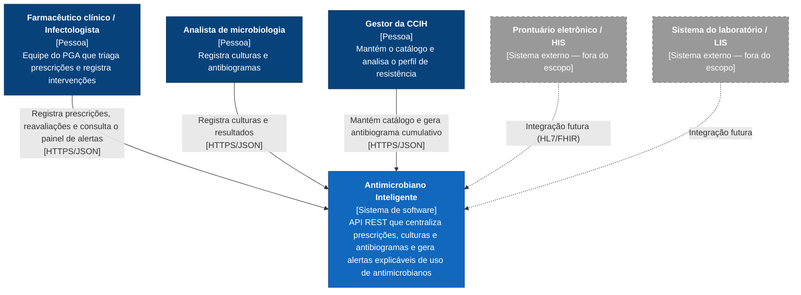
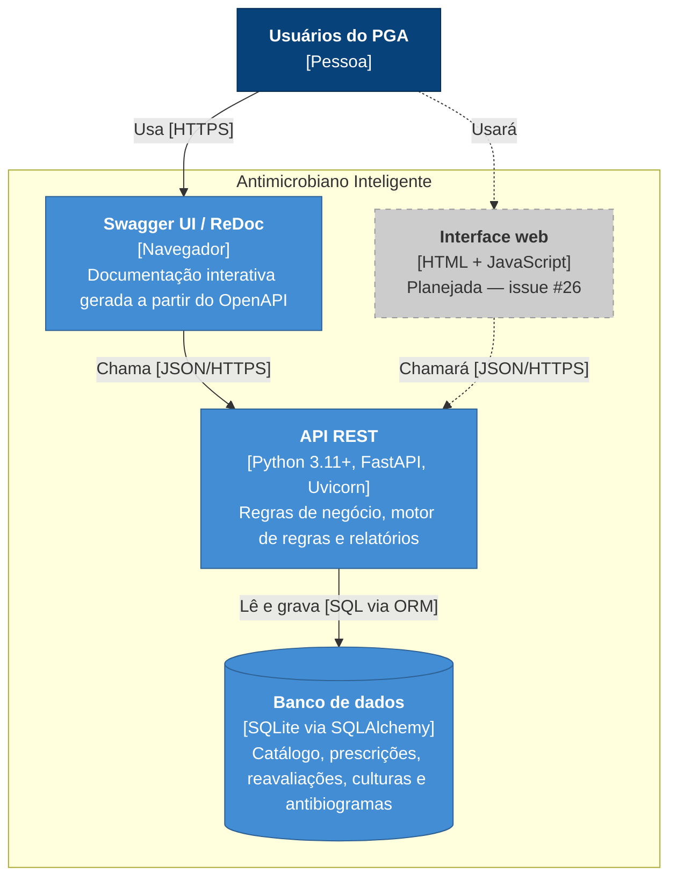
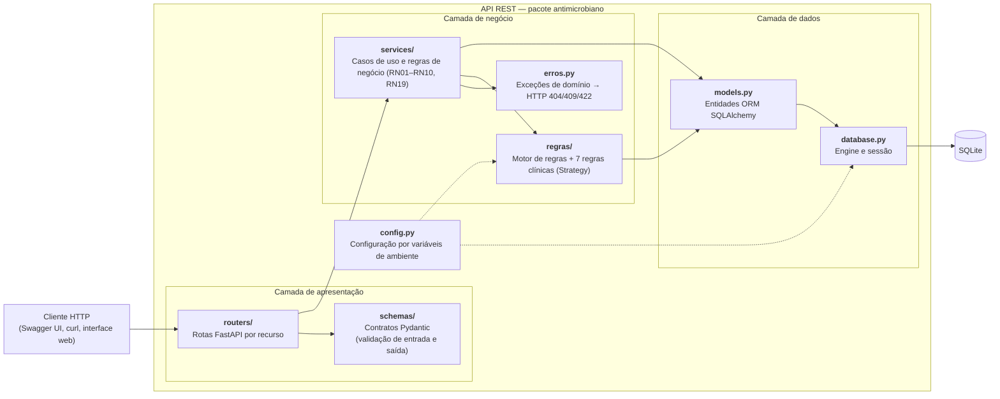

# Arquitetura

Visão arquitetural do **Antimicrobiano Inteligente** segundo o [modelo C4](https://c4model.com/) (contexto → contêineres → componentes), complementada pela arquitetura em camadas, pelo fluxo de geração de alertas e pelas principais decisões técnicas. O modelo de dados está em [modelo-de-dados.md](modelo-de-dados.md).

## 1. Nível 1 — Diagrama de contexto

## 2. Nível 2 — Diagrama de contêineres

## 3. Nível 3 — Diagrama de componentes da API

