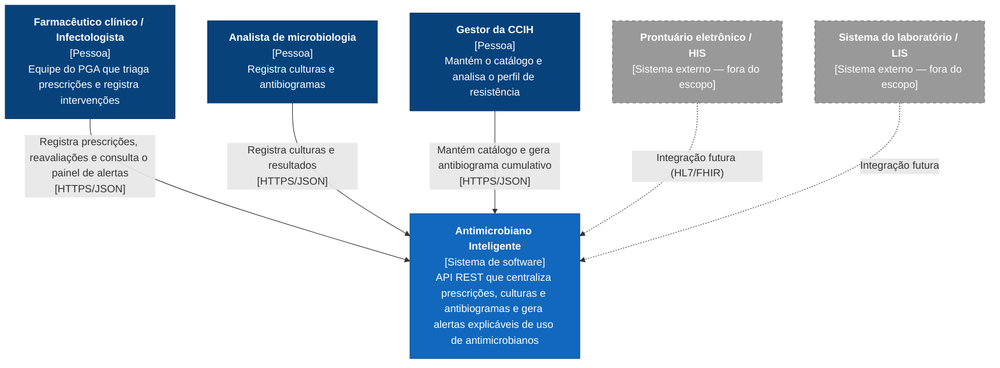
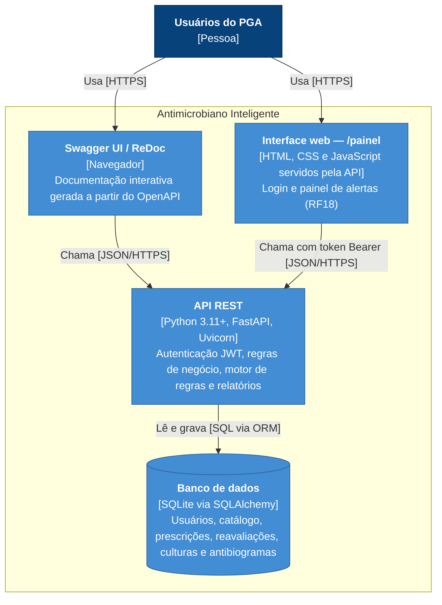
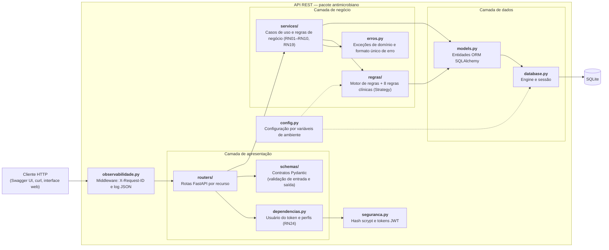
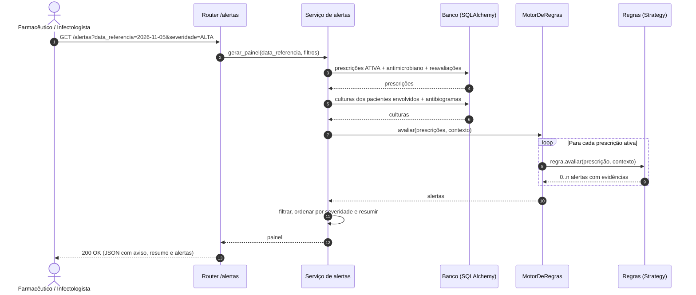

# Arquitetura

Visão arquitetural do **Antimicrobiano Inteligente** segundo o [modelo C4](https://c4model.com/) (contexto → contêineres → componentes), complementada pela arquitetura em camadas, pelo fluxo de geração de alertas e pelas principais decisões técnicas. O modelo de dados está em [modelo-de-dados.md](modelo-de-dados.md).

## 1. Nível 1 — Diagrama de contexto



## 2. Nível 2 — Diagrama de contêineres



**Implantação:** a API roda como um único processo Uvicorn. Para execução reprodutível, o `Dockerfile` gera uma imagem `python:3.12-slim` com usuário sem privilégios, e o `docker-compose.yml` monta o banco SQLite no volume `dados` e lê a configuração do `.env`. O CI constrói a imagem e verifica o `/health` a cada push e pull request.

## 3. Nível 3 — Diagrama de componentes da API



## 4. Arquitetura em camadas

| Camada | Pacote | Responsabilidade | Pode depender de |
|---|---|---|---|
| Apresentação | `routers/`, `schemas/` | Receber requisições HTTP, validar formato (Pydantic), serializar respostas e documentar o OpenAPI. | Negócio |
| Negócio | `services/`, `regras/`, `erros.py` | Aplicar as regras de negócio e os casos de uso; lançar exceções de domínio independentes de HTTP. | Dados |
| Dados | `models.py`, `database.py` | Mapear entidades para tabelas e gerenciar sessões/transações. | — |
| Transversal | `config.py`, `enums.py` | Configuração por ambiente e enumerações do domínio. | — |

As regras do motor **não acessam o banco**: recebem a prescrição e um contexto pré-carregado (culturas relevantes, parâmetros e data de referência). Isso as torna funções puras, testáveis isoladamente (RNF08), e evita consultas repetidas por prescrição (RNF01).

## 5. Motor de regras — padrão Strategy

- Cada regra é uma classe que implementa `avaliar(prescricao, contexto) -> list[Alerta]`.
- O `MotorDeRegras` recebe a lista de regras e as aplica a cada prescrição ativa.
- Incluir uma regra é criar uma nova classe e registrá-la no motor, **sem alterar as demais** (princípio aberto/fechado — RNF07). Foi assim que a duplicidade terapêutica (#22, RN22) entrou na v1.0.0: `RegraDuplicidadeTerapeutica` em `regras/politicas.py`, com o contexto passando a expor as prescrições ativas do paciente.
- Cada alerta carrega **evidências** (datas, dia de terapia, culturas, interpretações) para que a recomendação seja auditável (RNF10).

## 6. Fluxo de geração do painel de alertas



## 7. Recursos da API

| Método | Rota | Descrição | Requisito |
|---|---|---|---|
| `GET` | `/health` | Status e versão da aplicação (público) | RNF03 |
| `POST` | `/auth/login` | Entrar: devolve o token Bearer (público) | RF17 |
| `GET` | `/auth/me` | Usuário autenticado | RF17 |
| `POST` | `/usuarios` | Cadastrar usuário (GESTOR) | RF17 |
| `GET` | `/usuarios` | Listar usuários (GESTOR) | RF17 |
| `POST` | `/antimicrobianos` | Cadastrar antimicrobiano | RF01 |
| `GET` | `/antimicrobianos` | Listar com filtros | RF02 |
| `GET` | `/antimicrobianos/{id}` | Consultar | RF02 |
| `PATCH` | `/antimicrobianos/{id}` | Atualizar | RF02 |
| `DELETE` | `/antimicrobianos/{id}` | Inativar (exclusão lógica) | RF02 |
| `POST` | `/prescricoes` | Registrar prescrição | RF03 |
| `GET` | `/prescricoes` | Listar com filtros | RF04 |
| `GET` | `/prescricoes/{id}` | Consultar | RF04 |
| `PATCH` | `/prescricoes/{id}` | Atualizar prescrição ativa | RF04 |
| `POST` | `/prescricoes/{id}/reavaliacoes` | Registrar reavaliação (time-out) | RF05 |
| `GET` | `/prescricoes/{id}/reavaliacoes` | Histórico de reavaliações | RF05 |
| `POST` | `/prescricoes/{id}/encerramento` | Encerrar prescrição | RF05 |
| `POST` | `/culturas` | Registrar coleta | RF06 |
| `GET` | `/culturas` | Listar culturas | RF06 |
| `GET` | `/culturas/{id}` | Consultar cultura | RF06 |
| `PUT` | `/culturas/{id}/resultado` | Registrar resultado e antibiograma | RF06 |
| `GET` | `/alertas` | Painel de alertas inteligentes | RF07–RF13 |
| `GET` | `/relatorios/antibiograma-cumulativo` | Antibiograma cumulativo | RF14 |
| `GET` | `/relatorios/indicadores` | Indicadores de consumo (DOT) por antimicrobiano, categoria AWaRe e setor | RF15 |

**Autenticação:** exceto `/health`, `/docs`, `/redoc`, `/painel` e `POST /auth/login`, todas as rotas exigem o cabeçalho `Authorization: Bearer <token>` (`401` sem token válido). As operações de escrita verificam o perfil (`403`), conforme a RN24.

**Convenção de erros:** `404` recurso inexistente · `405` método não permitido · `409` conflito de estado ou de unicidade · `422` dados inválidos ou regra de negócio violada. Todas as respostas de erro — de negócio, de validação e do próprio framework — seguem o esquema único `Erro` (`erros.py`), com mensagens em português:

```json
{
  "codigo": "VALIDACAO",
  "mensagem": "Dados inválidos: verifique os campos informados.",
  "campos": [
    {"campo": "categoria_aware", "local": "body", "mensagem": "Valor inválido; use um destes: 'ACCESS', 'WATCH' ou 'RESERVE'."}
  ],
  "id_requisicao": "5f1c2a…"
}
```

| `codigo` | Status | Quando |
|---|---|---|
| `RECURSO_NAO_ENCONTRADO` | 404 | Recurso ou rota inexistente |
| `NAO_AUTENTICADO` | 401 | Token ausente, inválido ou expirado, ou credenciais incorretas |
| `ACESSO_NEGADO` | 403 | Perfil sem permissão para a operação |
| `METODO_NAO_PERMITIDO` | 405 | Método HTTP não aceito pela rota |
| `CONFLITO` | 409 | Unicidade ou estado do recurso (ex.: prescrição encerrada) |
| `REGRA_DE_NEGOCIO` | 422 | Dados bem formados que violam uma regra de negócio |
| `VALIDACAO` | 422 | Campo ausente, tipo ou formato inválido (`campos` indica cada problema) |
| `ERRO_INTERNO` | 500 | Falha inesperada: mensagem genérica, sem detalhes internos; o rastreamento fica no log com o mesmo `id_requisicao` |

**Observabilidade:** o middleware `MiddlewareDeObservabilidade` atribui a cada requisição um identificador (o `X-Request-ID` enviado pelo cliente, se válido, ou um UUID), devolve-o no cabeçalho da resposta e registra a requisição em JSON (`antimicrobiano.http`). Erros inesperados são registrados em `antimicrobiano.erros` com o rastreamento completo. O nível é definido por `AMI_LOG_NIVEL`.

## 8. Decisões de arquitetura

As decisões são registradas em [ADRs](adr/README.md), um arquivo por decisão, com contexto, alternativas e consequências:

| ADR | Decisão |
|---|---|
| [0001](adr/0001-python-e-fastapi.md) | Python e FastAPI na API REST |
| [0002](adr/0002-sqlite-e-sqlalchemy.md) | SQLite com SQLAlchemy 2.0 |
| [0003](adr/0003-motor-de-regras-strategy.md) | Motor de regras próprio no padrão Strategy |
| [0004](adr/0004-alertas-calculados-sob-demanda.md) | Alertas calculados sob demanda |
| [0005](adr/0005-paciente-por-codigo.md) | Paciente identificado apenas por código |
| [0006](adr/0006-pytest-e-github-actions.md) | pytest e GitHub Actions com gates de qualidade |
| [0007](adr/0007-autenticacao-jwt-e-perfis.md) | Autenticação por token JWT e perfis de acesso |
| [0008](adr/0008-formato-unico-de-erro.md) | Formato único de erro com mensagens em português |
| [0009](adr/0009-logs-estruturados.md) | Logs estruturados em JSON com identificador da requisição |
| [0010](adr/0010-interface-web-estatica.md) | Interface web estática servida pela própria API |
| [0011](adr/0011-execucao-em-docker.md) | Execução reprodutível com Docker |
