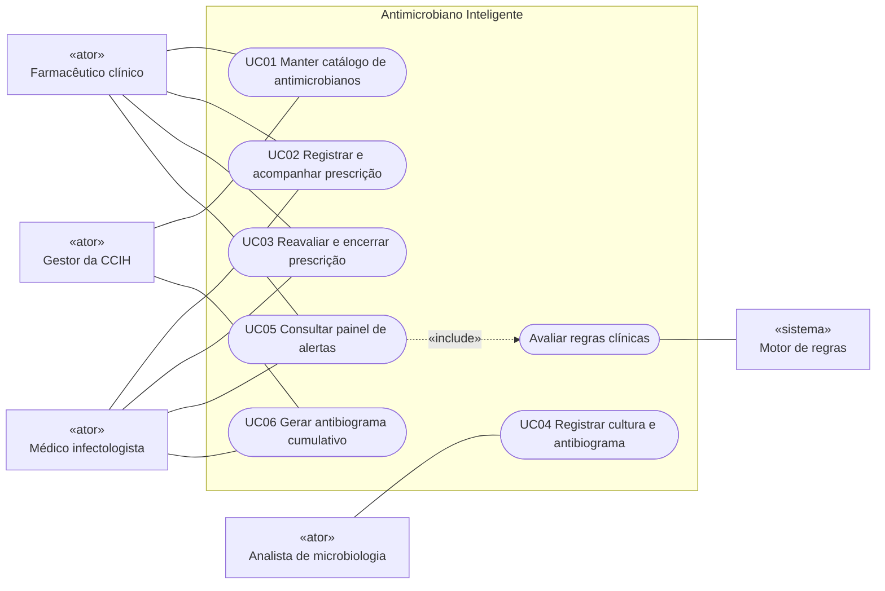

# Especificação de Casos de Uso

Casos de uso do **Antimicrobiano Inteligente**, derivados dos [requisitos](requisitos.md). Na iteração 1 todos os casos de uso são realizados pela API REST (Swagger UI em `/docs`); os códigos HTTP indicados nos fluxos de exceção fazem parte do contrato.

## 1. Atores

| Ator | Tipo | Descrição | Casos de uso |
|---|---|---|---|
| **Farmacêutico clínico** | Primário (humano) | Membro do PGA responsável pela triagem diária das prescrições de antimicrobianos e pelo registro das intervenções. | UC01, UC02, UC03, UC05 |
| **Médico infectologista** | Primário (humano) | Coordena clinicamente o PGA: reavalia tratamentos, corrige terapias inadequadas e decide descalonamentos. | UC02, UC03, UC05, UC06 |
| **Analista de microbiologia** | Primário (humano) | Profissional do laboratório que registra as culturas, os microrganismos isolados e os antibiogramas. | UC04 |
| **Gestor da CCIH** | Primário (humano) | Mantém a padronização do catálogo e acompanha o perfil local de resistência. | UC01, UC06 |
| **Motor de regras** | Secundário (sistema) | Componente interno que avalia as prescrições ativas em uma data de referência e produz os alertas. É acionado sempre que o painel é consultado. | UC05 |

## 2. Diagrama de casos de uso

## 3. Resumo

| UC | Nome | Atores primários | Requisitos | Issue |
|---|---|---|---|---|
| UC01 | Manter catálogo de antimicrobianos | Farmacêutico clínico, Gestor da CCIH | RF01, RF02 | #9 |
| UC02 | Registrar e acompanhar prescrição | Farmacêutico clínico, Médico infectologista | RF03, RF04 | #10 |
| UC03 | Reavaliar (time-out) e encerrar prescrição | Médico infectologista, Farmacêutico clínico | RF05 | #11 |
| UC04 | Registrar cultura e antibiograma | Analista de microbiologia | RF06 | #12 |
| UC05 | Consultar painel de alertas inteligentes | Farmacêutico clínico, Médico infectologista | RF07 a RF13 | #13 a #16 |
| UC06 | Gerar antibiograma cumulativo | Gestor da CCIH, Médico infectologista | RF14 | #17 |
| UC07 | Consultar indicadores de consumo (planejado) | Gestor da CCIH | RF15 | #21 |
| UC08 | Autenticar usuário (planejado) | Todos | RF17 | #24 |

---

## 4. Especificações

### UC01 — Manter catálogo de antimicrobianos

| Item | Descrição |
|---|---|
| **Objetivo** | Manter a lista padronizada de antimicrobianos do hospital, com a classificação usada pelo motor de regras. |
| **Atores** | Farmacêutico clínico (primário), Gestor da CCIH |
| **Requisitos** | RF01, RF02 · RN01, RN02, RN03 |
| **Pré-condições** | API em execução. |
| **Pós-condições** | Catálogo atualizado; itens inativos deixam de ser aceitos em novas prescrições. |

**Fluxo principal — cadastrar antimicrobiano**

1. O ator envia `POST /antimicrobianos` com nome, classe, categoria AWaRe e indicação de uso restrito.
2. O sistema valida os campos obrigatórios e a categoria AWaRe.
3. O sistema normaliza o nome e verifica a unicidade (RN01).
4. O sistema grava o antimicrobiano como **ativo** e responde `201 Created` com o registro e seu identificador.

**Fluxos alternativos**

- **FA01 — Listar com filtros:** o ator envia `GET /antimicrobianos` com filtros opcionais (`categoria_aware`, `uso_restrito`, `ativo`, `busca`). O sistema responde `200` com os itens ordenados por nome (por padrão, somente ativos).
- **FA02 — Consultar:** `GET /antimicrobianos/{id}` responde `200` com o item, mesmo que inativo.
- **FA03 — Atualizar:** `PATCH /antimicrobianos/{id}` com os campos alterados. Se o nome mudar, a RN01 é verificada novamente. Resposta `200`.
- **FA04 — Inativar:** `DELETE /antimicrobianos/{id}` marca o item como inativo, preservando o histórico (RN03). Resposta `204`.

**Fluxos de exceção**

- **FE01 — Nome duplicado (RN01):** `409 Conflict` com a mensagem "Já existe um antimicrobiano com este nome".
- **FE02 — Dados inválidos** (nome vazio, categoria inexistente): `422 Unprocessable Entity` indicando o campo.
- **FE03 — Antimicrobiano inexistente** em FA02, FA03 ou FA04: `404 Not Found`.

---

### UC02 — Registrar e acompanhar prescrição

| Item | Descrição |
|---|---|
| **Objetivo** | Registrar as prescrições de antimicrobianos para que sejam monitoradas pelo motor de regras. |
| **Atores** | Farmacêutico clínico (primário), Médico infectologista |
| **Requisitos** | RF03, RF04 · RN02, RN04 a RN08 · RNF04 |
| **Pré-condições** | Antimicrobiano cadastrado e ativo no catálogo (UC01). |
| **Pós-condições** | Prescrição registrada com status `ATIVA` e incluída na avaliação do painel (UC05). |

**Fluxo principal — registrar prescrição**

1. Na revisão diária do prontuário, o farmacêutico identifica um novo tratamento com antimicrobiano.
2. O ator envia `POST /prescricoes` com o código pseudonimizado do paciente, setor, antimicrobiano, dose, intervalo, via, indicação, diagnóstico, data de início, duração prevista e, se houver, a justificativa.
3. O sistema valida o código do paciente (RN04), a data de início (RN05) e os limites de duração e intervalo (RN06).
4. O sistema verifica se o antimicrobiano existe e está ativo (RN02).
5. O sistema grava a prescrição com status `ATIVA` e responde `201 Created`, incluindo o dia de terapia atual.

**Fluxos alternativos**

- **FA01 — Listar com filtros:** `GET /prescricoes?status=ATIVA&setor=UTI Adulto&paciente_codigo=PAC-0001` responde `200` com as prescrições ordenadas da data de início mais recente para a mais antiga.
- **FA02 — Consultar detalhe:** `GET /prescricoes/{id}` responde `200` com o antimicrobiano, as reavaliações e o dia de terapia.
- **FA03 — Atualizar prescrição ativa:** `PATCH /prescricoes/{id}` (ex.: inclusão da justificativa) responde `200`.
- **FA04 — Restrito sem justificativa:** o registro é aceito (RN07) e o alerta `RESTRITO_SEM_JUSTIFICATIVA` passa a aparecer no painel (UC05) até a justificativa ser registrada (FA03).

**Fluxos de exceção**

- **FE01 — Código de paciente fora do padrão** (ex.: um nome): `422` indicando `paciente_codigo`.
- **FE02 — Antimicrobiano inexistente:** `404`; **antimicrobiano inativo:** `422` com a mensagem "Antimicrobiano inativo não pode ser prescrito".
- **FE03 — Data de início futura, duração ou intervalo fora dos limites:** `422`.
- **FE04 — Prescrição inexistente** em FA02 ou FA03: `404`.
- **FE05 — Atualização de prescrição encerrada (RN08):** `409 Conflict`.

---

### UC03 — Reavaliar (time-out) e encerrar prescrição

| Item | Descrição |
|---|---|
| **Objetivo** | Documentar as intervenções do PGA: a reavaliação estruturada da terapia e o encerramento do tratamento. |
| **Atores** | Médico infectologista (primário), Farmacêutico clínico |
| **Requisitos** | RF05 · RN08, RN09 |
| **Pré-condições** | Prescrição com status `ATIVA` (UC02). |
| **Pós-condições** | Reavaliação registrada (o alerta de time-out deixa de ser exibido) ou prescrição encerrada (deixa de gerar alertas). |

**Fluxo principal — registrar reavaliação**

1. O infectologista identifica no painel um alerta de time-out (UC05).
2. Discute o caso com a equipe assistente e define a conduta.
3. O ator envia `POST /prescricoes/{id}/reavaliacoes` com a data, a conduta (`MANTER`, `AJUSTAR`, `DESCALONAR` ou `SUSPENDER`) e a observação.
4. O sistema verifica se a prescrição está ativa (RN08) e se a data é válida (RN09).
5. O sistema grava a reavaliação e responde `201 Created`.
6. Na próxima consulta ao painel, o alerta `TIMEOUT_REAVALIACAO` não é mais exibido para a prescrição.

**Fluxos alternativos**

- **FA01 — Encerrar prescrição:** o ator envia `POST /prescricoes/{id}/encerramento` com `status_final` (`CONCLUIDA` ou `SUSPENSA`), data de término e motivo. O sistema atualiza o status e responde `200`.
- **FA02 — Troca de antimicrobiano (conduta `AJUSTAR` ou `DESCALONAR`):** o ator encerra a prescrição atual como `SUSPENSA` (FA01) e registra uma nova prescrição com o novo antimicrobiano (UC02), preservando o histórico de cada tratamento.
- **FA03 — Consultar histórico:** `GET /prescricoes/{id}/reavaliacoes` responde `200` com as reavaliações em ordem cronológica.

**Fluxos de exceção**

- **FE01 — Prescrição encerrada (RN08):** `409 Conflict`.
- **FE02 — Data anterior ao início da prescrição ou futura (RN09):** `422`.
- **FE03 — Conduta ou status final inválido** (ex.: `status_final = ATIVA`): `422`.
- **FE04 — Prescrição inexistente:** `404`.

---

### UC04 — Registrar cultura e antibiograma

| Item | Descrição |
|---|---|
| **Objetivo** | Registrar culturas e antibiogramas de forma estruturada, permitindo o cruzamento automático com as prescrições. |
| **Atores** | Analista de microbiologia (primário) |
| **Requisitos** | RF06 · RN10 |
| **Pré-condições** | Antimicrobianos testados cadastrados no catálogo (UC01). |
| **Pós-condições** | Cultura registrada. Resultados positivos passam a alimentar as regras de resistência e descalonamento (UC05) e o antibiograma cumulativo (UC06); a simples coleta já satisfaz a regra de cultura obrigatória. |

**Fluxo principal — coleta e resultado positivo**

1. O analista registra a coleta com `POST /culturas` (paciente, setor, material e data de coleta).
2. O sistema valida os dados (RN04, RN10) e responde `201 Created` com status `PENDENTE`.
3. Após a identificação do microrganismo, o analista envia `PUT /culturas/{id}/resultado` com resultado `POSITIVA`, o microrganismo e o antibiograma (lista de antimicrobiano e interpretação `S`, `I` ou `R`).
4. O sistema valida o resultado (RN10) e a existência dos antimicrobianos informados.
5. O sistema grava o resultado e responde `200` com a cultura e o antibiograma.

**Fluxos alternativos**

- **FA01 — Cultura negativa:** `PUT /culturas/{id}/resultado` com resultado `NEGATIVA`, sem microrganismo e sem antibiograma. Resposta `200`.
- **FA02 — Correção de resultado:** um novo `PUT` substitui integralmente o resultado anterior.
- **FA03 — Listar culturas:** `GET /culturas?paciente_codigo=PAC-0001&status=POSITIVA` responde `200`, da coleta mais recente para a mais antiga.

**Fluxos de exceção**

- **FE01 — Resultado inconsistente** (positiva sem microrganismo, negativa com antibiograma, antimicrobiano repetido ou interpretação inválida): `422`.
- **FE02 — Antimicrobiano do antibiograma inexistente:** `422` identificando o item.
- **FE03 — Data de coleta futura ou data de resultado anterior à coleta:** `422`.
- **FE04 — Cultura inexistente:** `404`.

---

### UC05 — Consultar painel de alertas inteligentes

| Item | Descrição |
|---|---|
| **Objetivo** | Obter a lista priorizada de intervenções do dia, gerada pelo motor de regras. |
| **Atores** | Farmacêutico clínico e Médico infectologista (primários); Motor de regras (secundário) |
| **Requisitos** | RF07 a RF13 · RN11 a RN18, RN21 · RNF01, RNF10 |
| **Pré-condições** | Prescrições registradas (UC02). |
| **Pós-condições** | Nenhum dado é alterado (consulta). A equipe executa as intervenções em UC02 e UC03. |

**Fluxo principal**

1. O ator envia `GET /alertas`, opcionalmente com `data_referencia` e filtros (`tipo`, `severidade`, `setor`, `paciente_codigo`).
2. O sistema carrega as prescrições `ATIVA` (com antimicrobiano e reavaliações) e as culturas dos pacientes envolvidos.
3. **[Include — Avaliar regras clínicas]** O motor de regras aplica cada regra (RN12 a RN18) a cada prescrição na data de referência (padrão: hoje).
4. O sistema aplica os filtros, ordena os alertas por severidade (RN21) e calcula o resumo por severidade e por tipo.
5. O sistema responde `200` com a data de referência, o aviso de apoio à decisão, o total, o resumo e os alertas — cada um com tipo, severidade, prescrição, paciente, setor, antimicrobiano, mensagem, recomendação e evidências.
6. O ator prioriza os alertas `ALTA` e registra as intervenções (UC03) ou atualiza a prescrição (UC02).

**Fluxos alternativos**

- **FA01 — Nenhum alerta:** o sistema responde `200` com lista vazia e total 0.
- **FA02 — Planejamento da ronda:** o ator informa uma `data_referencia` futura (ex.: amanhã) para antecipar os alertas que surgirão.

**Fluxos de exceção**

- **FE01 — Parâmetros inválidos** (data em formato inválido, tipo ou severidade inexistentes): `422`.

---

### UC06 — Gerar antibiograma cumulativo

| Item | Descrição |
|---|---|
| **Objetivo** | Conhecer o perfil local de sensibilidade para orientar os protocolos de terapia empírica. |
| **Atores** | Gestor da CCIH (primário), Médico infectologista |
| **Requisitos** | RF14 · RN19, RN20 |
| **Pré-condições** | Culturas positivas com antibiograma registradas (UC04). |
| **Pós-condições** | Relatório gerado (consulta, sem alteração de dados). |

**Fluxo principal**

1. O ator envia `GET /relatorios/antibiograma-cumulativo?inicio=2026-01-01&fim=2026-06-30`.
2. O sistema seleciona as culturas `POSITIVA` coletadas no período.
3. O sistema mantém apenas o primeiro isolado por paciente e microrganismo (RN19).
4. O sistema agrega por microrganismo × antimicrobiano: testados, `S`, `I`, `R` e percentual de sensibilidade, sinalizando `amostra_suficiente`.
5. O sistema responde `200` com o período, o mínimo de isolados considerado e os resultados agrupados por microrganismo.

**Fluxos alternativos**

- **FA01 — Filtro por setor:** com `setor=UTI Adulto`, apenas culturas desse setor são consideradas.
- **FA02 — Nenhuma cultura no período:** o sistema responde `200` com lista vazia.

**Fluxos de exceção**

- **FE01 — Período inválido** (início posterior ao fim ou datas mal formatadas): `422`.

---

## 5. Casos de uso planejados (iteração 2)

- **UC07 — Consultar indicadores de consumo:** o gestor consulta os dias de terapia (DOT) por antimicrobiano e por categoria AWaRe em um período ([#21](https://github.com/Antonio-avsp/Projeto_Antimicrobiano_Inteligente/issues/21)).
- **UC08 — Autenticar usuário:** o usuário informa credenciais, recebe um token com expiração e passa a ter acesso conforme o perfil ([#24](https://github.com/Antonio-avsp/Projeto_Antimicrobiano_Inteligente/issues/24)).
