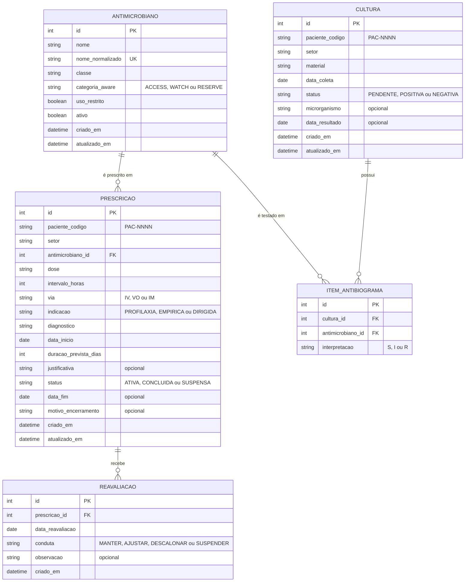

# Modelo de Dados

Modelo de dados do **Antimicrobiano Inteligente**: Diagrama Entidade-Relacionamento (DER), dicionário de dados e diagrama de classes. A persistência usa SQLite por meio do ORM SQLAlchemy (RNF02).

> **Decisão de privacidade (RNF04):** não existe tabela de pacientes. Prescrições e culturas referenciam o paciente apenas pelo código pseudonimizado `paciente_codigo` (`PAC-` + 4 a 10 dígitos). O vínculo entre prescrição e cultura é feito por esse código.

## 1. Diagrama Entidade-Relacionamento (DER)

**Cardinalidades**

- Um antimicrobiano pode estar em **zero ou muitas** prescrições; cada prescrição refere-se a **exatamente um** antimicrobiano.
- Uma prescrição recebe **zero ou muitas** reavaliações.
- Uma cultura positiva possui **zero ou muitos** itens de antibiograma; cada item refere-se a **um** antimicrobiano, que aparece no máximo uma vez por cultura (RN10).

## 2. Dicionário de dados

### 2.1 `antimicrobianos`

| Campo | Tipo | Obrig. | Restrições | Descrição |
|---|---|---|---|---|
| `id` | inteiro | sim | PK, autoincremento | Identificador |
| `nome` | texto (80) | sim | 2 a 80 caracteres | Nome comercial/genérico (ex.: Ceftriaxona) |
| `nome_normalizado` | texto (80) | sim | **único** | Nome em minúsculas, sem acentos e sem espaços extras (RN01) |
| `classe` | texto (80) | sim | 2 a 80 caracteres | Classe farmacológica |
| `categoria_aware` | enum | sim | `ACCESS`, `WATCH`, `RESERVE` | Classificação AWaRe da OMS |
| `uso_restrito` | booleano | sim | padrão `false` | Exige justificativa (RN07) |
| `ativo` | booleano | sim | padrão `true` | Inativação lógica (RN02, RN03) |
| `criado_em`, `atualizado_em` | data e hora | sim | automáticos (UTC) | Auditoria (RNF09) |

### 2.2 `prescricoes`

| Campo | Tipo | Obrig. | Restrições | Descrição |
|---|---|---|---|---|
| `id` | inteiro | sim | PK | Identificador |
| `paciente_codigo` | texto (15) | sim | `^PAC-\d{4,10}$`, indexado | Paciente pseudonimizado (RN04) |
| `setor` | texto (60) | sim | 2 a 60 caracteres | Setor de internação |
| `antimicrobiano_id` | inteiro | sim | FK → `antimicrobianos.id` | Antimicrobiano prescrito (deve estar ativo — RN02) |
| `dose` | texto (40) | sim | 1 a 40 caracteres | Dose por administração (ex.: "1 g") |
| `intervalo_horas` | inteiro | sim | 1 a 168 | Intervalo entre doses (RN06) |
| `via` | enum | sim | `IV`, `VO`, `IM` | Via de administração |
| `indicacao` | enum | sim | `PROFILAXIA`, `EMPIRICA`, `DIRIGIDA` | Finalidade da terapia |
| `diagnostico` | texto (120) | sim | 3 a 120 caracteres | Diagnóstico/sítio de infecção ou procedimento |
| `data_inicio` | data | sim | ≤ hoje | Início da terapia (RN05) |
| `duracao_prevista_dias` | inteiro | sim | 1 a 90 | Duração planejada (RN06) |
| `justificativa` | texto (500) | não | — | Justificativa clínica (RN07) |
| `status` | enum | sim | `ATIVA`, `CONCLUIDA`, `SUSPENSA` | Situação da prescrição |
| `data_fim` | data | não | início ≤ data ≤ hoje | Data de término (RN09) |
| `motivo_encerramento` | texto (300) | não | — | Motivo informado no encerramento |
| `criado_em`, `atualizado_em` | data e hora | sim | automáticos (UTC) | Auditoria |

### 2.3 `reavaliacoes`

| Campo | Tipo | Obrig. | Restrições | Descrição |
|---|---|---|---|---|
| `id` | inteiro | sim | PK | Identificador |
| `prescricao_id` | inteiro | sim | FK → `prescricoes.id`, indexado | Prescrição reavaliada |
| `data_reavaliacao` | data | sim | início ≤ data ≤ hoje | Data do time-out (RN09) |
| `conduta` | enum | sim | `MANTER`, `AJUSTAR`, `DESCALONAR`, `SUSPENDER` | Decisão tomada |
| `observacao` | texto (500) | não | — | Detalhes da intervenção |
| `criado_em` | data e hora | sim | automático (UTC) | Auditoria |

### 2.4 `culturas`

| Campo | Tipo | Obrig. | Restrições | Descrição |
|---|---|---|---|---|
| `id` | inteiro | sim | PK | Identificador |
| `paciente_codigo` | texto (15) | sim | `^PAC-\d{4,10}$`, indexado | Paciente pseudonimizado |
| `setor` | texto (60) | sim | 2 a 60 caracteres | Setor de coleta |
| `material` | enum | sim | `SANGUE`, `URINA`, `SECRECAO_TRAQUEAL`, `LIQUOR`, `PONTA_DE_CATETER`, `SECRECAO_DE_FERIDA`, `OUTRO` | Material biológico |
| `data_coleta` | data | sim | ≤ hoje | Data da coleta (RN10) |
| `status` | enum | sim | `PENDENTE`, `POSITIVA`, `NEGATIVA` | Situação do exame |
| `microrganismo` | texto (120) | condicional | obrigatório se `POSITIVA` | Microrganismo isolado |
| `data_resultado` | data | não | coleta ≤ data ≤ hoje | Data de liberação do resultado |
| `criado_em`, `atualizado_em` | data e hora | sim | automáticos (UTC) | Auditoria |

### 2.5 `itens_antibiograma`

| Campo | Tipo | Obrig. | Restrições | Descrição |
|---|---|---|---|---|
| `id` | inteiro | sim | PK | Identificador |
| `cultura_id` | inteiro | sim | FK → `culturas.id` (exclusão em cascata) | Cultura de origem |
| `antimicrobiano_id` | inteiro | sim | FK → `antimicrobianos.id` | Antimicrobiano testado |
| `interpretacao` | enum | sim | `S`, `I`, `R` | Interpretação BrCAST/EUCAST |
| (`cultura_id`, `antimicrobiano_id`) | — | — | **único** | Um antimicrobiano por antibiograma (RN10) |
